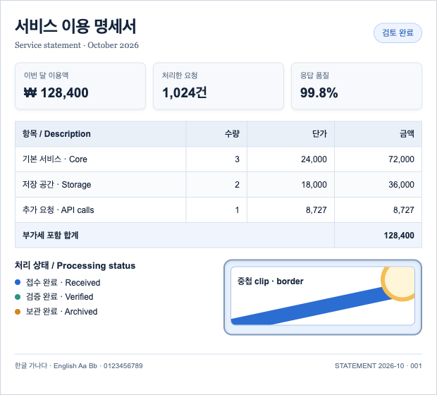

# Comins Capture

<a href="https://comins-website.vercel.app/ko/"></a>

[Comins Brand](https://comins-website.vercel.app/ko/)

Browser-side static HTML capture for Vanilla JavaScript, React, Vue, and Svelte,
built on one TypeScript core and a pinned SnapDOM engine. Capture a connected
element once and export PNG, JPEG, Canvas, or foreignObject SVG at a requested
scale, custom size, or ISO/JIS paper size. WebP requires native encoder support.

[English docs](docs/README.md) · [한국어 가이드](docs/ko/01-quick-start.md)
· [Capture website](https://comins-website.vercel.app/ko/capture/)

**0.0.1 candidate — not published to npm.** Use a maintainer-provided tarball.
The Capture website is a development introduction; current contracts are in
this repository's guides.



This is a real 620×560 PNG output from the 2026-10-15 Chrome benchmark,
not a screenshot of the Playground. See [preview provenance](docs/assets/README.md)
for its fixture, runtime and evidence limits.

## Features

| Capability | What to try in the Playground |
| --- | --- |
| Single output | Generate and save PNG, JPEG, foreignObject SVG, or native-supported WebP. |
| Scale and custom size | Compare CSS 1×, 2×, captured device DPR and custom 800×600 output. |
| ISO/JIS paper | Select A3/A4/A5/B3/B4/B5, orientation and margins. Raster defaults to 300 PPI; SVG uses mm. |
| Layout and background | Compare contain, cover, stretch and backgrounds. APIs also expose alignment and encoder quality. |
| Snapshot reuse | Export several formats from one validated SVG without recapturing the source. |
| Resources and lifecycle | Use default-deny resources, explicit origins or a Blob resolver, cancellation, timeout and disposal. |

The target is ordinary static HTML. Crop, tiles, partial output, full-page capture,
Shadow DOM, form/scroll state and PDF are outside 0.0.1. See
[input and resources](docs/user/05-resources.md).

## Installation

Registry installation is not available yet. Copy the reviewed candidate tarball
into the consuming application and install it there:

```sh
npm install --ignore-scripts ./comins-capture-0.0.1.tgz
```

Use Node.js 24 or later and ESM. A browser bundler or application-owned import
map must resolve the package root. There are no framework subpath packages or
framework peer dependencies. Your application supplies its framework runtime.

## Quick Start

Call capture after the target has rendered. Keep controls outside the target.

```js
import {capture} from 'comins-capture';

const target = document.querySelector('#card');
if (!(target instanceof HTMLElement)) throw new Error('Missing capture target');
const snapshot = await capture(target);
try {
  const {value: blob, meta} = await snapshot.toBlob({
    format:'png',
    size:{kind:'paper', name:'A4', ppi:300},
    background:'#fff',
  });
  // Use blob and meta.width/meta.height; A4 is 2480×3508 px at 300 PPI.
} finally {
  snapshot.dispose();
}
```

`toBlob()` returns `{value, meta}`. Applications own and revoke the Blob URLs
they create. Images and web fonts may require a resolver or explicit origin
policy. The [complete quick start](docs/user/01-quick-start.md) includes HTML,
download handling and cleanup.

## Choose a framework

| Framework | Readiness and ownership | Guide |
| --- | --- | --- |
| Vanilla JavaScript | Connected HTMLElement and application cleanup | [Vanilla](docs/user/03-frameworks.md#vanilla-javascript) |
| React | ref, user event, effect cleanup; fresh owner per StrictMode setup | [React](docs/user/03-frameworks.md#react) |
| Vue | ref, nextTick and onUnmounted | [Vue](docs/user/03-frameworks.md#vue) |
| Svelte | bind:this, tick and onDestroy | [Svelte](docs/user/03-frameworks.md#svelte) |

All frameworks import from `comins-capture`. Root import and paper calculation
are DOM-free; capture itself requires a browser. The session helper is example
code, not a public export.

## Guides and API

- [English quick start](docs/user/01-quick-start.md) · [한국어 시작하기](docs/ko/01-quick-start.md)
- [Documentation index](docs/README.md) · [Core concepts](docs/user/02-core-concepts.md)
- [Output and paper options](docs/user/04-output-options.md) · [Input and resources](docs/user/05-resources.md)
- [Lifecycle and errors](docs/user/06-lifecycle-errors.md) · [Playground](docs/user/07-playground.md)
- [Public API reference](docs/user/09-public-api.md) · [한글 API](docs/ko/09-public-api.md)

```js
import {paperSize} from 'comins-capture';
paperSize('A4'); // {width:2480, height:3508}; ISO, 300 PPI
paperSize('B4', {standard:'JIS', orientation:'landscape'});
```

Output options use `system:'jis'`; paperSize uses `standard:'JIS'`. PPI computes
pixels without rewriting file DPI metadata. SVG contains foreignObject and is
not a pure vector or design-tool interchange format.

## Run the Playground locally

```sh
git clone https://github.com/kim1124/comins-capture.git
cd comins-capture
npm ci --ignore-scripts
npm run verify
npm run dev
```

Open [the Capture Playground](http://127.0.0.1:6004). Override the port with
CAPTURE_PORT. The server has no HMR; rebuild after source changes. Reset restores
defaults and clears results. `node examples/geometry.mjs` runs without a DOM.

## 0.0.1 candidate

The initial release focuses on static HTML, single output, scale, custom sizes
and ISO/JIS paper. Unfinished crop, tile and partial paths have been removed.
Actual Chrome 154.0.8037.98 on macOS/DPR2 passed 15 single-output/lifecycle/error
and 15 resource/SVG checks on the benchmark runtime. The 64-node statement's
capture-to-PNG measured p50 183.6 ms and p95 198.9 ms across 10 samples; 30
sequential captures had zero failures. Paper dimensions passed 24 ISO/JIS and
orientation cases, with JIS values corroborated from public supplier/manufacturer
tables. JISC login is not required for this dimension check.

Publication, remote CI and release closure remain separate steps. The exact
artifact and source identity are recorded in the checkout's release worklog.
See [browser evidence and limits](docs/user/08-browser-support.md).

## Browser support and limits

Chrome technical quality is conditionally accepted for the measured static
scope. Native Safari is excluded because known shadow/clip failures remain.
Edge, Firefox and physical mobile devices are unverified for this candidate.
Installed Chrome 155 metadata and WebKit tests do not establish native runtime
support. Broad CSS, low-end systems, long-duration memory and full-image pixel
equality are not guaranteed. Canvas is limited to 8192 px per side and
32,000,000 px total.

## Repository guidance

The [contribution guide](https://github.com/kim1124/comins-capture/blob/codex-governance-v111/CONTRIBUTING.md), [repository guide](https://github.com/kim1124/comins-capture/blob/codex-governance-v111/docs/development/repository-guide.md)
and [release preparation](https://github.com/kim1124/comins-capture/blob/codex-governance-v111/docs/development/releasing.md) are checkout-only
maintainer documents. User references are distributed with the package.

## License and support

[MIT](LICENSE) · [Changelog](https://github.com/kim1124/comins-capture/blob/codex-governance-v111/CHANGELOG.md) ·
[Issues](https://github.com/kim1124/comins-capture/issues) ·
[Comins Brand](https://comins-website.vercel.app/ko/)

The build supplies a pinned, minimally modified SnapDOM 3.2.0 engine behind an
internal adapter, with upstream license and provenance. See
[third-party notices](THIRD_PARTY_NOTICES.md). Public declarations expose no engine types.
